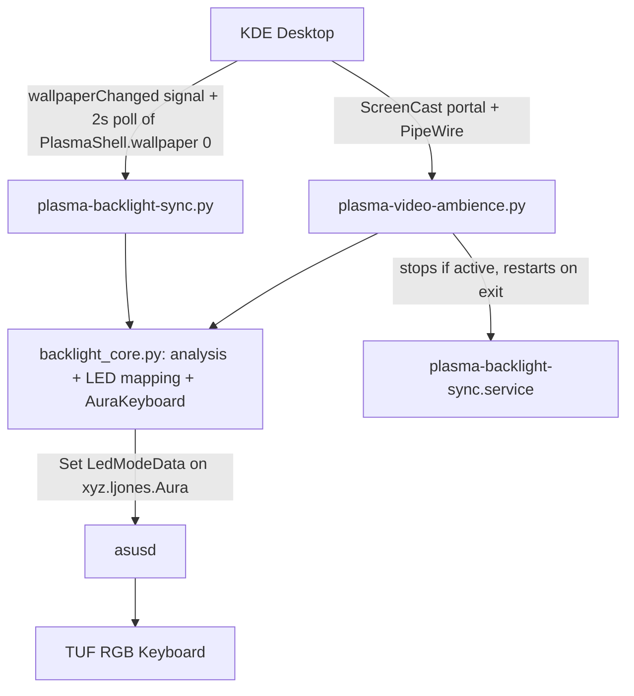

# Project Map: Plasma Backlight Control

This project controls the RGB backlighting on ASUS TUF gaming laptops under Linux, coordinating keyboard illumination dynamically based on either the current desktop wallpaper (static daemon) or real-time screen content (video ambience mode).

Verified stack (2026-10-31): Plasma 6.8.2, asusctl/asusd 6.5.0, Python 3.14.8, Pillow 13.0, PyGObject 3.58.1, PipeWire/gst-plugin-pipewire 1.6.10, ScreenCast portal v6.

---

## 1. High-Level Architecture

---

## 2. File & API Registry

| File Path | Purpose | Key APIs |
| :--- | :--- | :--- |
| `backlight_core.py` | Shared colour engine and keyboard output | `load_thumbnail()`, `analyze_image()`, `led_rgb()`, `AuraKeyboard`, `ColorCache`, `load_config()`, `add_signal_handler()` |
| `plasma-backlight-sync.py` | Wallpaper sync daemon; `--analyze IMG…` CLI | `WallpaperSync.query_wallpaper/check/apply/fade_to/reload`, `resolve_wallpaper_path()` |
| `plasma-video-ambience.py` | Real-time screen ambience | `Ambience._request()` (portal helper), `_on_new_sample()` (GStreamer thread), `_tick()` (30 Hz main loop) |
| `plasma-backlight-sync.service` | systemd user unit (`ExecReload` = SIGHUP) | `%h/.local/bin/plasma-backlight-sync.py` |
| `install.sh` | Copies scripts + core to `~/.local/bin`, installs unit, restarts | — |
| `udev/90-asus-kbd-rgb.rules` | Installed at `/etc/udev/rules.d/` (2026-10-31): chgrp wheel + g+w on `kbd_rgb_mode` | `AuraKeyboard._write_sysfs()` |

---

## 3. How to Deploy / Run
- Deploy: `./install.sh` (installed copies must stay identical to the repo; check with `diff -q`).
- Logs: `journalctl --user -u plasma-backlight-sync -f`.
- Config: optional `~/.config/plasma-backlight-sync.conf` `[backlight]` (gamma, saturation, min/max_brightness, transition_ms); apply with `systemctl --user reload plasma-backlight-sync`.
- Test colour choices without touching the keyboard: `plasma-backlight-sync.py --analyze <images>`.
- Ambience: `~/.local/bin/plasma-video-ambience.py`; restore token in `~/.cache/plasma-backlight-sync/screencast-restore-token` (delete to re-pick monitor).

---

## 4. Core Algorithm (backlight_core.py, ALGO_VERSION 2)
1. `load_thumbnail`: JPEG `draft()` decode, EXIF transpose in place, resize straight from the visible centre box (FillMode 2 = PreserveAspectCrop → screen aspect) to 96 px. No full-res copies.
2. `analyze_image`: Pillow median-cut to 20 clusters (C code, ~3 ms) → OKLab per cluster → score `C^1.5 · area^0.4 · usable(L)` (usable: smoothstep 0.15–0.40, fades out above 0.90) → area/score-weighted average of clusters within ±30° hue of the winner. Max chroma < 0.025 ⇒ neutral (area-weighted mean of lit clusters).
3. `led_rgb`: OKLab → sRGB (chroma-reduced gamut mapping) → HSV saturation × `saturation` → channels at full value raised to `gamma` → × level, where level = lerp(min, max, smoothstep(0.08, 0.45, 0.5·sceneL + 0.5·accentL)).
4. Sync daemon: 300 ms debounce, 800 ms smoothstep cross-fade in output RGB at 30 Hz, analysis cached by path+mtime+size+crop+ALGO_VERSION.
5. Ambience: 64×36 RGB frames, analysis ≤30 fps in streaming thread; main-loop EMA with the original adaptive alpha (0.08 calm → 0.85 cuts, per-60fps, rescaled by dt).

---

## 5. Conventions & Gotchas
- **asusd rewrites `/etc/asusd/aura_tuf.ron` on every `LedModeData` Set** → always go through `AuraKeyboard.set_rgb` (dedupes identical colours). Transient colours use `persist=False` (fade steps, ambience frames) → written as `0 0 r g b 0` to `/sys/class/leds/asus::kbd_backlight/kbd_rgb_mode` (kernel: cmd 0 = apply/0xB3, 1 = save to BIOS/0xB4); `persist=True` (final fade colour) also goes to asusd. Measured: one wallpaper fade = 24 direct writes + 1 asusd rewrite. Falls back to asusd-only if the attribute is not writable.
- asusd persists the last colour itself, so suspend/resume and asusd restarts restore it without help.
- Aura object path is discovered by introspecting `/xyz/ljones/aura` (fallback `/tuf`).
- `pipewiresrc path=` is deprecated but still correct: the portal returns a node id, `target-object` wants a name/serial.
- PyGObject ≥3.52 deprecates `GLib.unix_signal_add`; use `add_signal_handler()` (GLibUnix with fallback).
- `/PlasmaShell` PropertiesChanged only covers `editMode`/`shell` — not useful for wallpaper detection.
- Colour tuning changes: bump `ALGO_VERSION` so the cache invalidates.

## 6. Pending
- LED gamma default (1.8) was chosen without on-keyboard calibration; tune via config after eyeballing.
