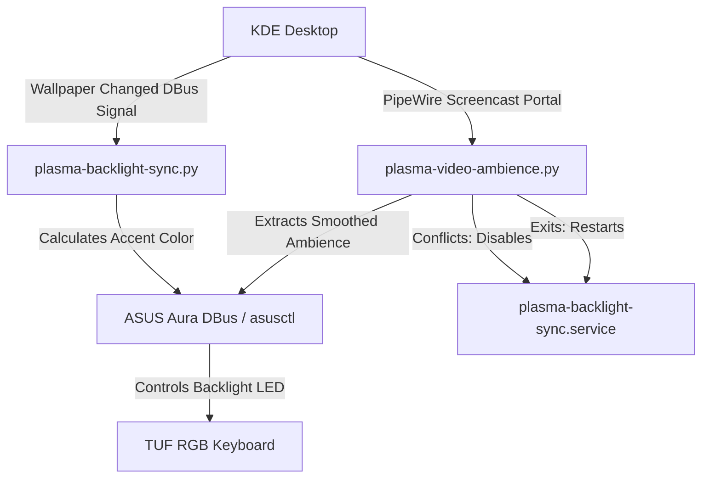

# Project Map: Plasma Backlight Control

This project controls the RGB backlighting on ASUS TUF gaming laptops under Linux, coordinating keyboard illumination dynamically based on either the current desktop wallpaper (static daemon) or real-time screen content (video ambience mode).

---

## 1. High-Level Architecture

---

## 2. File & API Registry

| File Path | Primary Purpose | Key APIs & Functions | Dependencies |
| :--- | :--- | :--- | :--- |
| [plasma-backlight-sync.py](file:///home/meoclavezz/Projects/plasma-backlight-control/plasma-backlight-sync.py) | Background wallpaper-backlight sync daemon. | `get_current_wallpaper()`, `get_highlight_color(path)`, `set_keyboard_color(hex)` | `dbus`, `PIL` (Pillow), `colorsys` |
| [plasma-video-ambience.py](file:///home/meoclavezz/Projects/plasma-backlight-control/plasma-video-ambience.py) | Real-time screen-content ambience sync daemon. | `start()`, `on_new_sample(appsink)`, `update_smoothed_color(r,g,b)`, `screencast.CreateSession()` | `gi.repository` (Gst, GstApp, GLib), `dbus` |
| [plasma-backlight-sync.service](file:///home/meoclavezz/Projects/plasma-backlight-control/plasma-backlight-sync.service) | Systemd user unit to manage the wallpaper daemon. | Standard systemd service hooks (`ExecStart`, `PartOf`, `WantedBy`) | Systemd user-session |

---

## 3. Core Algorithms & Logic Flow

### A. Wallpaper Sync Daemon (`plasma-backlight-sync.py`)
*   **Trigger:** Listens on the DBus Session Bus for the signal `wallpaperChanged` on `org.kde.PlasmaShell`.
*   **Calculation Logic:**
    1.  Downscales the wallpaper image to `64x64` to filter out high-frequency noise and speed up processing.
    2.  Converts the pixels to HLS (Hue, Lightness, Saturation) space.
    3.  Filters out dark/black pixels (`Lightness < 0.08`) to prevent noise from taking over.
    4.  Computes a weighted average of coordinates in HLS, weighting by `Lightness * (Saturation^2)` to emphasize high-saturation zones.
    5.  Checks proximity and area size (bin quantization) of colors to smoothly blend the weighted average with the dominant vibrant color.
    6.  Adapts keyboard backlighting brightness dynamically based on overall screen brightness (dims in dark rooms).
*   **backlight Interface:** Communicates via system DBus with `xyz.ljones.Asusd` at `/xyz/ljones/aura/tuf` using static mode or falls back to running `asusctl aura effect static --colour <hex>`.

### B. Video Ambience Mode (`plasma-video-ambience.py`)
*   **Conflicts Handling:** Upon starting, it stops the background wallpaper service `plasma-backlight-sync` via `systemctl --user stop`. On exit, it restarts the service.
*   **Screen Capture:**
    1.  Uses `org.freedesktop.portal.ScreenCast` to request a PipeWire screen capture session.
    2.  Spawns a GStreamer pipeline with: `pipewiresrc fd=<fd> ! videoconvert ! videoscale ! video/x-raw,width=32,height=32,format=RGB ! appsink name=sink`
    3.  Pulls buffer samples inside `on_new_sample()` at a capped frame rate (max ~60fps) to minimize CPU usage.
*   **Smoothing Interpolation:**
    To avoid rapid flashing/jittering, colors are updated using an exponential moving average (`current = current * (1 - alpha) + target * alpha`), where the responsiveness factor (`alpha`) scales dynamically:
    *   **Small color changes:** `alpha = 0.08` (slow, smooth blending).
    *   **Large color flashes/cuts:** `alpha = 0.85` (near-instant response).
