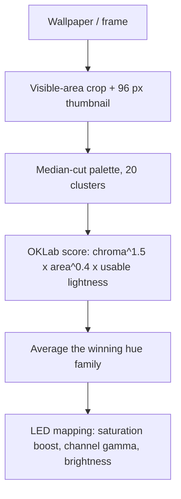

# Plasma Keyboard Backlight Sync & Video Ambience

A pair of lightweight ambient lighting daemons for KDE Plasma 6 on Linux (built for ASUS TUF/ROG laptops using `asusd`/`asusctl`).

The keyboard backlight follows your wallpaper (including slideshows) or, on demand, the live screen content.

Tested on: Plasma 6.8, asusctl 6.5, Python 3.14, Pillow 13, PyGObject 3.58, PipeWire 1.6.

---

## Features

### 🌌 Wallpaper Sync (`plasma-backlight-sync.py`)
- Detects wallpaper changes via the `org.kde.PlasmaShell` D-Bus API (signal + 2 s poll, since Plasma 6 does not signal slideshow rotations).
- Analyses only what is visible: honours Plasma's *Scaled and Cropped* fill mode and screen aspect ratio.
- Wallpaper packages: picks the image matching your screen's aspect/resolution and the `images_dark` variant when the colour scheme is dark.
- Smooth eased cross-fade between colours; bursts of changes (slideshow start-up) are coalesced.
- Persistent colour cache (`~/.cache/plasma-backlight-sync/colors.json`) — repeat wallpapers cost ~0 ms.
- Low footprint: ~20 MB resident, decoded image buffers are returned to the OS after each analysis.
- `systemctl --user reload plasma-backlight-sync` re-reads the config and re-applies the current colour.

### 🎬 Video Ambience (`plasma-video-ambience.py`)
- PipeWire screen capture through the XDG ScreenCast portal (cursor hidden).
- **Remembers the portal grant**: after the first run, it starts without the monitor-selection dialog.
- Frame analysis runs in the GStreamer thread; a 30 Hz main-loop timer applies adaptive smoothing (slow blend for calm scenes, near-instant on cuts/flashes).
- Writes only when the colour actually changes (static scenes cause zero writes); frames go straight to `kbd_rgb_mode` when the udev rule is installed.
- Pauses the wallpaper sync service while running and always restores it on exit (including a cancelled prompt), but only if it was running before.

### 🎨 Colour Engine (`backlight_core.py`, shared)

- Perceptual OKLab space instead of HLS (HLS reports dark noise as fully saturated).
- Saturated subjects beat large dull backgrounds; greyscale images give a neutral white.
- **LED gamma correction**: RGB LEDs are linear, sRGB values are not — without correction oranges turn yellow and pastels turn white.
- Brightness follows both the scene and the accent, so a bright subject on a black wallpaper still glows.

---

## Installation

```bash
# Arch Linux
sudo pacman -S python-gobject python-dbus python-pillow gst-plugin-pipewire asusctl
sudo systemctl enable --now asusd

./install.sh   # copies to ~/.local/bin, installs + (re)starts the user service
```

### Direct keyboard writes (recommended)
asusd rewrites `/etc/asusd/aura_*.ron` on every colour change. This rule lets `wheel` members write the kernel's
`kbd_rgb_mode` attribute directly, so fade steps and video frames skip asusd; only each wallpaper's final colour is
stored in asusd (it survives suspend/reboot). Without it everything still works through asusd.
```bash
sudo install -m 644 udev/90-asus-kbd-rgb.rules /etc/udev/rules.d/
sudo udevadm control --reload
sudo udevadm trigger --action=change --subsystem-match=leds --sysname-match='asus::kbd_backlight'
systemctl --user restart plasma-backlight-sync
```

### Video Ambience
```bash
~/.local/bin/plasma-video-ambience.py     # Ctrl+C to stop
```
To pick a different monitor, delete `~/.cache/plasma-backlight-sync/screencast-restore-token`.

### Inspect colour choices
```bash
plasma-backlight-sync.py --analyze ~/Pictures/*.jpg
# accent #9b6a55  led #fd7044  scene L 0.41  /home/.../a.jpg
```

---

## Configuration (optional)

`~/.config/plasma-backlight-sync.conf` — every key is optional:

```ini
[backlight]
gamma = 1.8            ; LED channel gamma (1.0 = raw sRGB). Raise if colours look washed out.
saturation = 1.15      ; saturation multiplier before gamma
min_brightness = 0.15  ; LED level for black wallpapers / dark scenes
max_brightness = 1.0   ; LED level for bright wallpapers / scenes
transition_ms = 800    ; wallpaper cross-fade (0 = instant)
```
Apply with `systemctl --user reload plasma-backlight-sync`.
